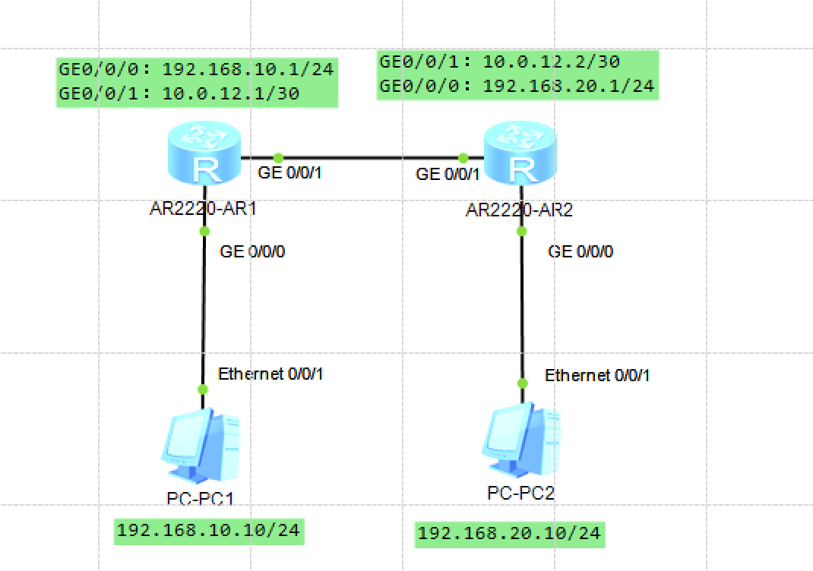
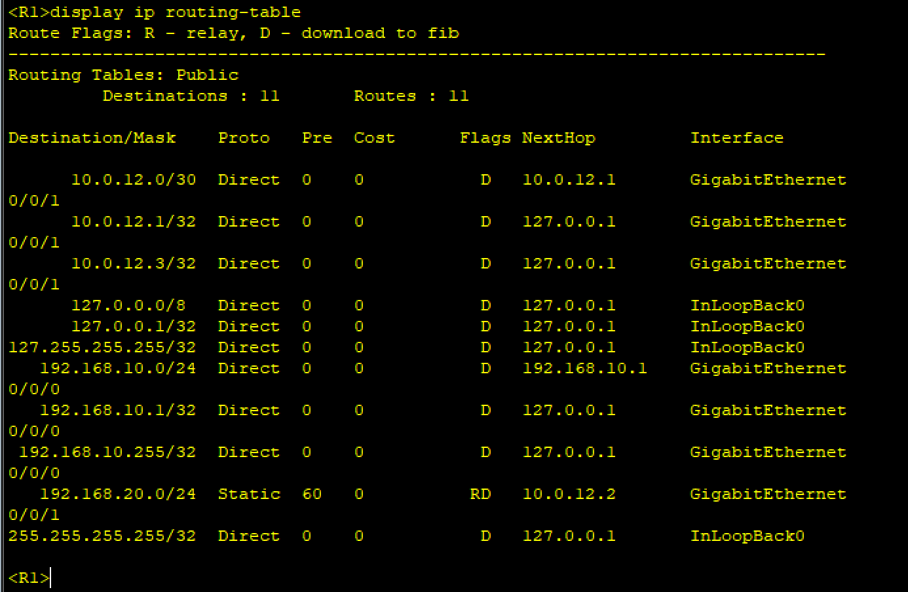
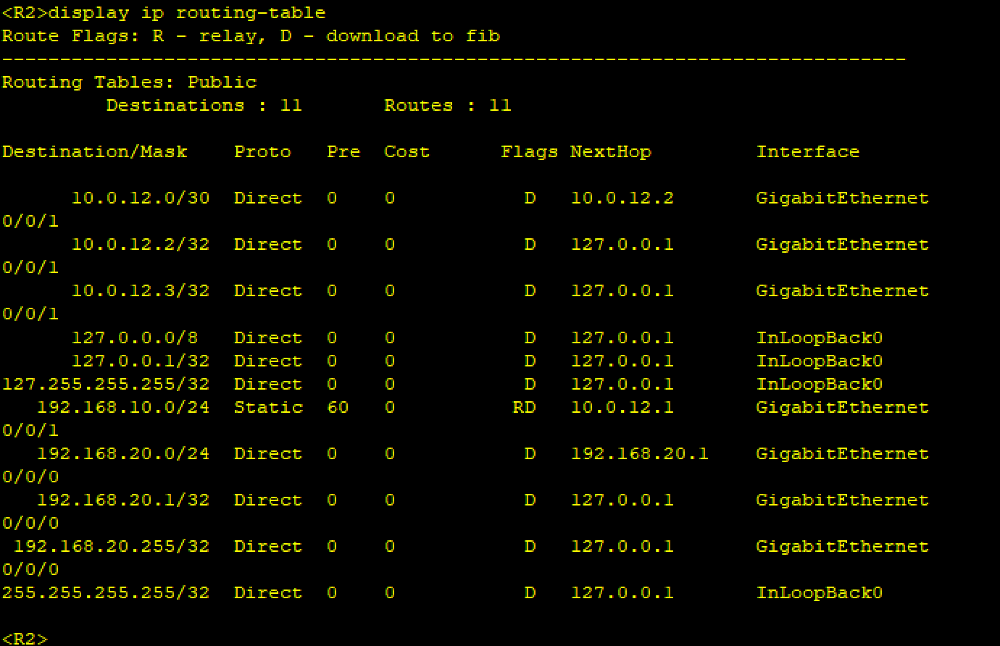

# 实验十五：eNSP 华为路由器静态路由配置与跨网段通信

## 一、实验基本信息

- **实验编号：** 实验十五
- **仓库学习记录序号：** 17
- **实验名称：** eNSP 华为路由器静态路由配置与跨网段通信
- **实验日期：** 2026-11-24
- **实验时间：** 具体起止时间未单独记录
- **实验环境：** eNSP
- **路由器型号：** Huawei AR2220
- **实验设备：** AR2220 路由器 × 2、PC × 2
- **实验状态：** 配置完成，跨网段通信验证通过
- **学习阶段：** 第七阶段——交换与路由基础实验
- **知识掌握程度：** 初步掌握，路由转发过程及静态路由原理仍需巩固

## 二、实验目的

1. 理解路由器的基本作用以及不同网段之间的通信原理。
2. 掌握华为 AR2220 路由器接口 IP 地址配置方法。
3. 掌握 PC 静态 IP 地址、子网掩码和默认网关的配置方法。
4. 掌握华为路由器静态路由命令 `ip route-static`。
5. 学会使用 `display ip routing-table` 查看路由表。
6. 通过 Ping 测试验证不同网段之间的双向通信。

## 三、实验拓扑

本实验使用两台华为 AR2220 路由器和两台 PC，构建两个不同网段，通过路由器互联实现跨网段通信。



### 1. 设备连接关系

| 设备 | 接口 | 连接设备 | 接口 |
|---|---|---|---|
| PC1 | Ethernet | R1 | GE0/0/0 |
| R1 | GE0/0/1 | R2 | GE0/0/1 |
| R2 | GE0/0/0 | PC2 | Ethernet |

网络连接关系：

```text
PC1 —— R1 —— R2 —— PC2
```

其中，R1 与 R2 之间使用独立的 `/30` 网段进行互联。

## 四、IP 地址规划

| 设备 | 接口 | IP 地址 | 子网掩码 | 默认网关 |
|---|---|---|---|---|
| PC1 | Ethernet | 192.168.10.10 | 255.255.255.0 | 192.168.10.1 |
| R1 | GE0/0/0 | 192.168.10.1 | 255.255.255.0 | — |
| R1 | GE0/0/1 | 10.0.12.1 | 255.255.255.252 | — |
| R2 | GE0/0/1 | 10.0.12.2 | 255.255.255.252 | — |
| R2 | GE0/0/0 | 192.168.20.1 | 255.255.255.0 | — |
| PC2 | Ethernet | 192.168.20.10 | 255.255.255.0 | 192.168.20.1 |

### 网段划分

- PC1 所在网段：`192.168.10.0/24`
- R1 与 R2 互联网段：`10.0.12.0/30`
- PC2 所在网段：`192.168.20.0/24`

## 五、路由器与 PC 配置

### 1. R1 配置

进入系统视图并设置设备名称：

```text
system-view
sysname R1
```

配置连接 PC1 的接口：

```text
interface GigabitEthernet 0/0/0
ip address 192.168.10.1 255.255.255.0
undo shutdown
quit
```

配置连接 R2 的接口：

```text
interface GigabitEthernet 0/0/1
ip address 10.0.12.1 255.255.255.252
```

### 2. R2 配置

进入系统视图并设置设备名称：

```text
system-view
sysname R2
```

配置连接 R1 的接口：

```text
interface GigabitEthernet 0/0/1
ip address 10.0.12.2 255.255.255.252
```

配置连接 PC2 的接口：

```text
interface GigabitEthernet 0/0/0
ip address 192.168.20.1 255.255.255.0
undo shutdown
```

### 3. PC1 与 PC2 配置

通过 eNSP PC 设备的基础配置界面设置静态 IP 地址。

**PC1：**

- IP 地址：192.168.10.10
- 子网掩码：255.255.255.0
- 默认网关：192.168.10.1

**PC2：**

- IP 地址：192.168.20.10
- 子网掩码：255.255.255.0
- 默认网关：192.168.20.1

配置完成后，分别执行：

```text
ipconfig
```

确认两台 PC 的 IP 地址、子网掩码和默认网关正确。

## 六、静态路由配置

### 1. R1 添加静态路由

R1 需要知道如何到达 PC2 所在的 `192.168.20.0/24` 网段。

执行：

```text
system-view
ip route-static 192.168.20.0 255.255.255.0 10.0.12.2
```

命令含义：

- 目标网络：192.168.20.0
- 子网掩码：255.255.255.0
- 下一跳地址：10.0.12.2（R2）

表示访问 `192.168.20.0/24` 网段时，将数据包转发给 R2。

### 2. R2 添加静态路由

R2 需要知道如何返回 PC1 所在的 `192.168.10.0/24` 网段。

执行：

```text
system-view
ip route-static 192.168.10.0 255.255.255.0 10.0.12.1
```

命令含义：

- 目标网络：192.168.10.0
- 子网掩码：255.255.255.0
- 下一跳地址：10.0.12.1（R1）

表示访问 `192.168.10.0/24` 网段时，将数据包转发给 R1。

## 七、配置验证与通信测试

### 1. 接口状态检查

在路由器上执行：

```text
display ip interface brief
```

检查各接口的 IP 地址及物理状态、协议状态。

实验最终 R1 的 GE0/0/0 接口恢复为 UP/UP，路由器之间的互联接口及 R2 的 PC 侧接口也正常工作。

### 2. 路由表检查

分别在 R1 和 R2 上执行：

```text
display ip routing-table
```



R1 中成功出现目标网段的静态路由：

```text
192.168.20.0/24  Static  60  0  RD  10.0.12.2  GigabitEthernet0/0/1
```

R2 中成功出现返回网段的静态路由：



```text
192.168.10.0/24  Static  60  0  RD  10.0.12.1  GigabitEthernet0/0/1
```

验证结果：两台路由器均成功配置了指向对端局域网的静态路由。

### 3. PC1 到 PC2 通信测试

在 PC1 上执行：

```text
ping 192.168.20.10
```

第一次测试结果：

- 发送数据包：5
- 接收数据包：3
- 丢包率：40%

第一次测试前两次出现超时，后三次成功。

随后重新执行 Ping 测试，结果如下：

```text
PC>ping 192.168.20.10

Ping 192.168.20.10: 32 data bytes, Press Ctrl_C to break
From 192.168.20.10: bytes=32 seq=1 ttl=126 time=16 ms
From 192.168.20.10: bytes=32 seq=2 ttl=126 time=15 ms
From 192.168.20.10: bytes=32 seq=3 ttl=126 time=32 ms
From 192.168.20.10: bytes=32 seq=4 ttl=126 time=31 ms
From 192.168.20.10: bytes=32 seq=5 ttl=126 time<1 ms

--- 192.168.20.10 ping statistics ---
5 packet(s) transmitted
5 packet(s) received
0.00% packet loss
round-trip min/avg/max = 0/18/32 ms
```

最终测试结果：

- 发送数据包：5
- 接收数据包：5
- 丢包率：0%
- 平均延迟：18 ms
- 最大延迟：32 ms

**最终验证：PC1 到 PC2 跨网段通信成功。**


## 八、实验过程中的问题与排错

### 1. 路由器接口状态异常

实验过程中，R1 的 GE0/0/0 接口最初显示 DOWN，导致接口通信异常。

解决方法：

重新进入接口视图并执行：

```text
system-view
interface GigabitEthernet 0/0/0
undo shutdown
display ip interface brief
```

随后检查接口状态，最终接口恢复为 UP/UP。

### 2. 路由器命令输入位置错误

配置过程中，曾误在 PC1 的命令行中输入路由器配置命令，导致设备提示命令无效。

解决方法：

确认当前打开的是 R1 或 R2 的路由器命令行窗口，再执行 VRP 配置命令。

### 3. PC 静态 IP 配置问题

eNSP 普通 PC 命令行不支持预期的静态 IP 配置命令。

解决方法：

通过 PC 的基础配置界面设置 IP 地址、子网掩码和默认网关，之后使用 `ipconfig` 验证。

### 4. 第一次 Ping 出现丢包

第一次测试出现 40% 丢包，但后续三次已经成功。

重新测试后，5 个数据包全部接收成功，丢包率为 0%。

首次通信可能涉及 ARP 地址解析等初始化过程，不能仅凭第一次 Ping 的结果判断静态路由配置失败。

## 九、实验原理总结

### 1. 静态路由的作用

静态路由是由网络管理员手动配置的路由信息，路由器根据路由表决定数据包的转发方向。

本实验中，两台路由器分别连接不同的局域网，需要通过静态路由告诉对方如何到达远端网络。

### 2. 下一跳地址

下一跳是路由器转发数据包时需要交付给的下一个路由设备地址。

本实验中：

- R1 的下一跳地址为 `10.0.12.2`。
- R2 的下一跳地址为 `10.0.12.1`。

### 3. 默认网关

PC 访问其他网段时，需要将数据包发送给默认网关，由网关负责后续路由转发。

本实验中：

- PC1 的默认网关为 `192.168.10.1`。
- PC2 的默认网关为 `192.168.20.1`。

### 4. 双向路由的重要性

跨网段通信不仅需要请求方向的路由，还需要返回方向的路由。

本实验中，R1 配置了前往 PC2 网段的静态路由，R2 配置了返回 PC1 网段的静态路由，因此实现了双向通信。

## 十、实验结论

本次实验使用两台华为 AR2220 路由器和两台 PC，完成了路由器接口 IP 地址配置、PC 静态地址配置以及双向静态路由配置。

通过 `display ip routing-table` 检查，确认 R1 和 R2 均存在正确的静态路由。

通过 PC1 向 PC2 发送 Ping 请求，最终实现了 5 个数据包全部接收、0% 丢包的跨网段通信。

本次实验进一步理解了静态路由、下一跳地址、默认网关以及双向路由的作用，初步掌握了华为路由器静态路由的配置与验证方法。

**实验完成情况：**

- [x] 创建 eNSP 网络拓扑
- [x] 配置 R1 接口 IP 地址
- [x] 配置 R2 接口 IP 地址
- [x] 配置 PC1、PC2 静态 IP 和默认网关
- [x] 配置 R1 静态路由
- [x] 配置 R2 静态路由
- [x] 检查两台路由器的路由表
- [x] 完成 PC1 到 PC2 的跨网段 Ping 测试
- [x] 最终测试达到 0% 丢包

**实验结论：实验成功。**

## 十一、学习进度记录

### 1. 学习进度

- [x] 理解静态路由的基本作用
- [x] 掌握路由器接口 IP 地址配置
- [x] 掌握 PC 默认网关配置
- [x] 掌握华为静态路由配置命令
- [x] 理解下一跳地址的含义
- [x] 完成跨网段通信实验

### 2. 实验验证

- [x] R1 接口状态检查
- [x] R2 接口状态检查
- [x] R1 静态路由检查
- [x] R2 静态路由检查
- [x] PC1 到 PC2 Ping 测试
- [x] 最终 0% 丢包验证

### 3. 知识掌握

本次实验已经完成静态路由配置和跨网段通信验证，能够根据目标网络和下一跳地址配置静态路由，并通过路由表检查配置结果。

后续需要进一步巩固路由器查表转发过程、最长前缀匹配，以及静态路由与动态路由的区别。

**后续学习方向：** 学习 RIP 动态路由协议，对比静态路由和动态路由在配置方式、路由学习和网络维护方面的区别。
